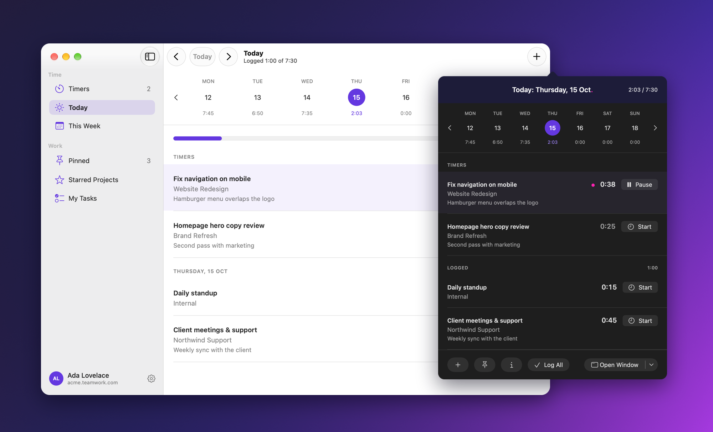
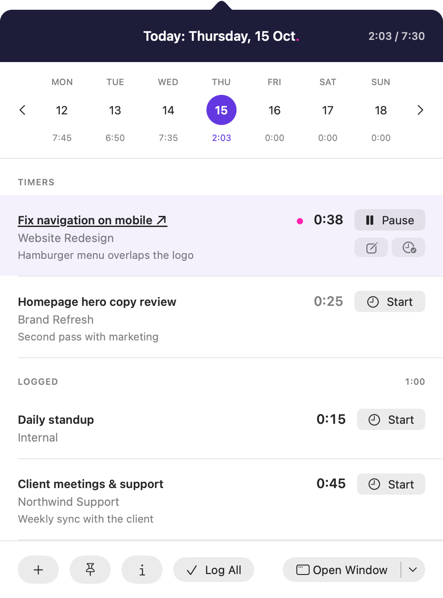
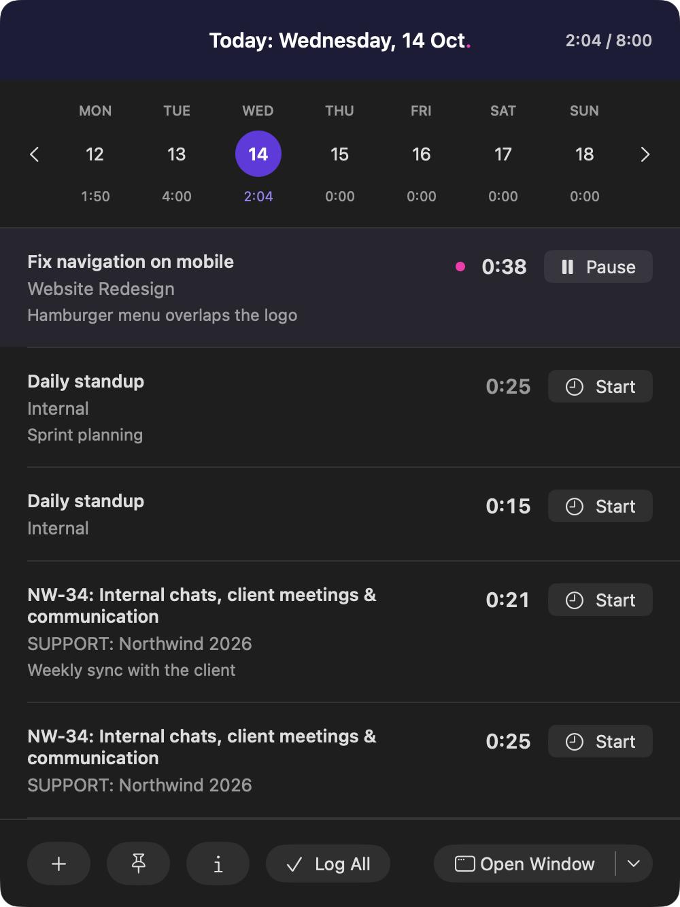
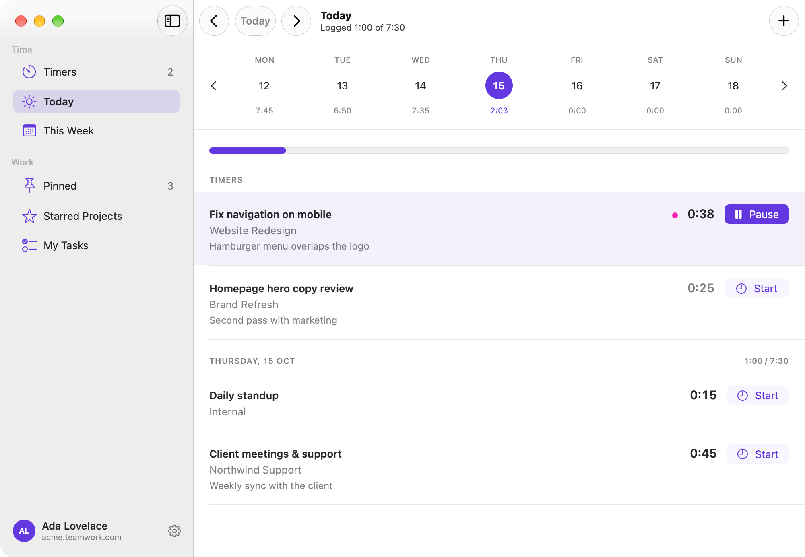
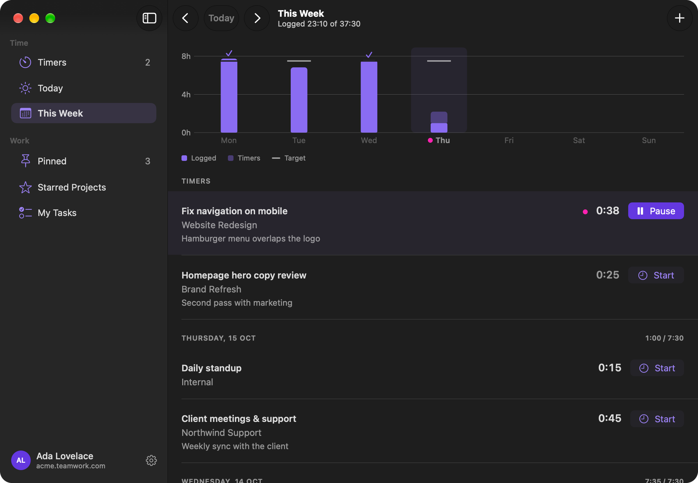
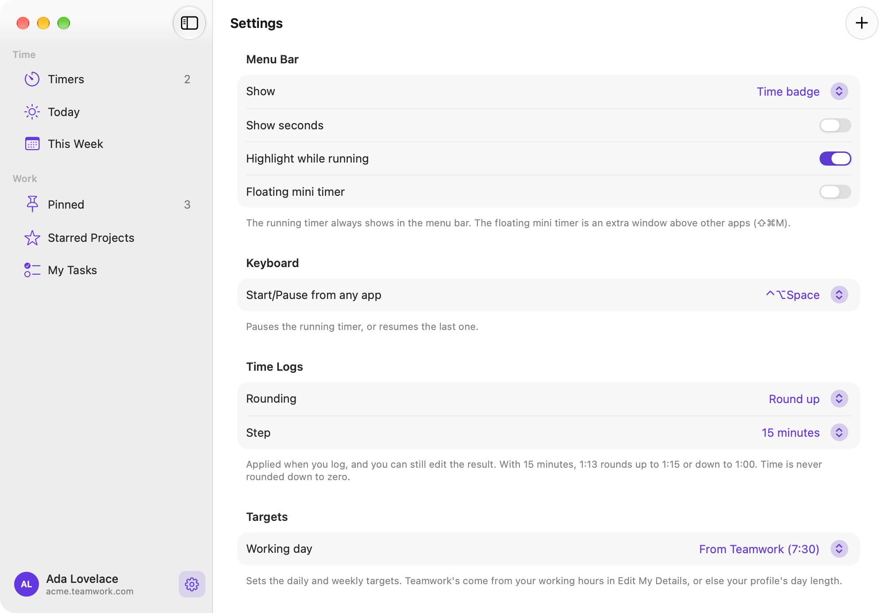

<p align="center">
  
</p>

<h1 align="center">Stint for Teamwork</h1>

<p align="center">
  A fast, native macOS menu bar timer for <a href="https://www.teamwork.com">Teamwork.com</a>.<br>
  Built in SwiftUI for Apple silicon. An independent project, not made or endorsed by Teamwork.com.
</p>

<p align="center">
  <a href="https://github.com/doxigo/stint/actions/workflows/build.yml"></a>
  
  
</p>

---

## Why

Teamwork's own desktop timer is an Electron 4 app that runs under Rosetta and feels it. Stint is a small native app that lives in the menu bar, uses Teamwork's own server timers (so a timer you start on the web shows up here, and the other way round), and keeps tracking down to a click or a keystroke.

## Features

- **Menu bar first.** The running timer ticks in the menu bar as time, task and time, or just an icon, and turns into a purple pill while it runs.
- **A popover for the whole day.** Today's timers and logged time, a week strip with daily totals, one-click Start and Pause, and your daily target from your Teamwork working hours (or your own, in Settings).
- **Pinned tasks.** Pin the work you repeat and start it with ⌘1–⌘9.
- **Starred projects, Due Today and Recent** at the top of every picker. Search any task or project, or paste a Teamwork task link.
- **Log with care.** Edit the duration (`1:30`, `1.5h`, `90m`), round up or down to a step you choose, mark the task complete, or log every timer at once.
- **Edit as you go.** Move a running timer to another task, change its notes, billable or tracked time, and edit or delete logged entries.
- **Idle detection.** Come back from a break and choose to keep the idle time, or remove it and continue or stop.
- **Reminders.** A nudge at the end of the working day if timers are left, and an alert for timers left running too long.
- **A library window.** Timers, Today, This Week, Pinned, Starred Projects and My Tasks, with Settings and your account in the same window.
- **Light and Dark Mode**, in Teamwork's palette.

## Screenshots

<table>
  <tr>
    <td width="50%"></td>
    <td width="50%"></td>
  </tr>
  <tr>
    <td></td>
    <td></td>
  </tr>
  <tr>
    <td></td>
    <td align="center"><br><sub>The menu bar while a timer runs</sub></td>
  </tr>
</table>

<sub>Screenshots use sample data.</sub>

## Install

1. Download `Stint.dmg` from the latest [release](https://github.com/doxigo/stint/releases) and open it.
2. Drag **Stint** onto the Applications folder, then open it from Applications.

Releases are signed with a Developer ID and notarized once the signing secrets below are configured. Until then they are published as **unsigned releases**: macOS blocks the first launch. Open the app, click **Done** on the warning, then click **Open Anyway** in **System Settings › Privacy & Security › Security** (it's there for about an hour) and enter your login password to confirm. Or run `xattr -dr com.apple.quarantine "/Applications/Stint.app"`.

Requires macOS 26 or later. After that, Stint updates itself from these releases. To turn that off, open Settings › Updates.

## Sign in

Open the window (⌘0 from the popover), then **Sign In** at the bottom of the sidebar.

- **Sign in with Teamwork**: Teamwork's login page opens in a Stint window. Sign in (single sign-on works too) and the window closes by itself. It keeps no Teamwork cookies afterwards. Release builds offer this once Stint's own Teamwork app is registered. Builds without it (including your own builds from source) show the two options below instead.

Under **Advanced**:

- **API token**: in Teamwork, open your profile, choose **Edit My Details**, then **API & Mobile**, and copy the token. Enter your site (for example `acme.teamwork.com`) and the token.
- **Your own app** (OAuth): create an app in your site's Developer Portal (`https://<your-site>/developer`), add a redirect URL, and paste its client ID and secret. The redirect can be `stint://oauth/callback` or a loopback address such as `http://localhost:8123` (the default).

Credentials are stored in your Keychain. Builds signed without an Apple Developer certificate ask for your login password once after each update; choose **Always Allow**.

## Keyboard

| Shortcut | Action |
| --- | --- |
| ⌘N | New timer |
| ⌘↩ | Pause the running timer, or resume the last one |
| ⌘1–⌘9 | Start a pinned task (popover) |
| ⌘1–⌘6 | Switch pages (window) |
| ← → | Previous or next day (popover) |
| ⌘0 | Open the main window |
| ⌘, | Settings |
| ⌘R | Refresh |

A global Start/Pause shortcut can be set in Settings.

## Build from source

You need macOS 26 and either Xcode 26 or the Command Line Tools.

```bash
./check.sh    # models, OAuth validation, mocked session/logging/pagination, and release packaging checks
./bundle.sh   # builds, signs and installs "/Applications/Stint.app"
```

`bundle.sh` signs with a self-signed identity it creates once in `.signing/` (git-ignored), so the Keychain keeps recognising the app between local builds. "Sign in with Teamwork" needs the built-in client from `TEAMWORK_CLIENT_ID` and `TEAMWORK_CLIENT_SECRET`; without them, a local install keeps the client of the Stint it replaces, so rebuilding never drops it. Release builds only take it from those variables. Every push to `main` runs checks and a release build on GitHub Actions. A `v*` tag publishes a release: signed, notarized and stapled when the secrets below exist, otherwise an unsigned release whose notes say how to open it.

For public releases, configure these GitHub Actions secrets:

- `MACOS_CERTIFICATE_P12`: base64-encoded Developer ID Application certificate, including its private key.
- `MACOS_CERTIFICATE_PASSWORD`: the exported certificate's password.
- `APPLE_ID`, `APPLE_APP_PASSWORD`, `APPLE_TEAM_ID`: the Apple account, app-specific password, and team for notarization.
- `TEAMWORK_CLIENT_ID` and, optionally, `TEAMWORK_CLIENT_SECRET`: Stint's Developer Portal app, for **Sign in with Teamwork**. `bundle.sh` writes them into the built app only, never the repo. A secret shipped in an app can be read out of it; [DESIGN.md](DESIGN.md#built-in-sign-in) covers that trade-off.
- `TEAMWORK_REDIRECT` (an Actions *variable*, optional): the redirect registered for that app. `stint://oauth/callback` (the default) signs in through a browser sheet that shares your browser's Teamwork session; `https://www.teamwork.com/callback` signs in inside Stint's own window instead.

For a signed local release, import your Developer ID Application identity, create a profile with `xcrun notarytool store-credentials`, then run:

```bash
SIGNING_IDENTITY="Developer ID Application: Your Name (TEAMID)" NOTARY_PROFILE="your-profile" ./bundle.sh
```

The notarized disk image is `build/Stint.dmg`. Local builds without these variables use the development signing identity and are not public release artifacts.

Account data is isolated by site and user. Pins, recents and idle adjustments saved before that are adopted once by the first account that signs in.

If a logging response is lost, check Teamwork before retrying. The log form lets you confirm that the entry exists and remove the leftover timer, or confirm that no entry exists and allow a retry. Successful posts awaiting timer removal are recorded atomically on disk, so restarting the app does not post them again.

[DESIGN.md](DESIGN.md) holds the reverse-engineering notes on the old app, the information architecture, and the Teamwork API details.

## Project layout

```
Sources/TeamworkTimer/
  TeamworkTimerApp.swift   scenes and menu commands
  Store.swift              app state, polling, caching, logging rules
  TeamworkClient.swift     Teamwork v3 API (timers, time logs, tasks, projects)
  Auth.swift               Keychain, Launchpad OAuth, the sign-in window, stint:// and loopback redirects
  Popover.swift            the menu bar popover
  MainWindow.swift         the library window
  Chrome.swift, Brand.swift  the shared design system and palette
Checks/                    assert checks and anonymised API fixtures
```

## Disclaimer

An independent project, not affiliated with or endorsed by Teamwork.com. "Teamwork" and the Teamwork brand colours belong to their owners.
